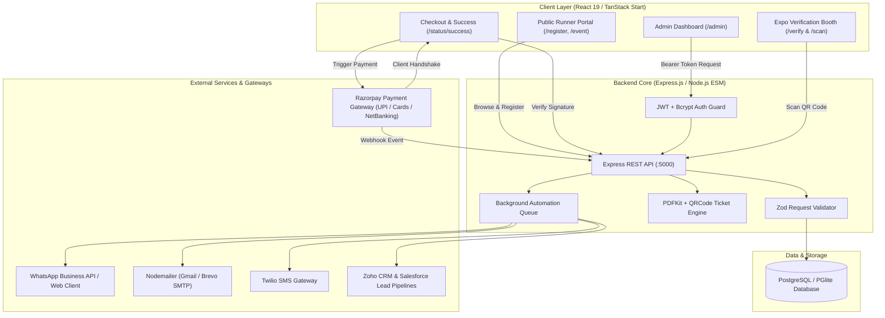
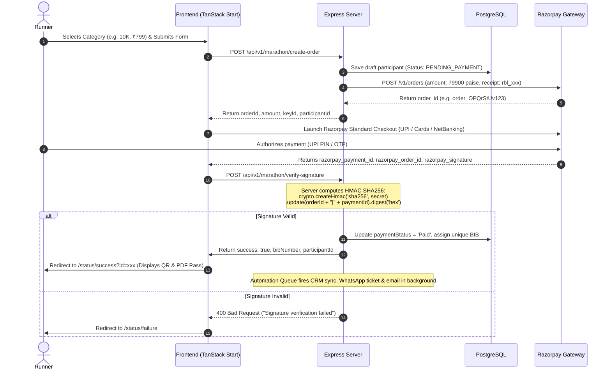

# Run Beyond Limits 2026: Case Study
*A Full-Stack Marathon Event Registration, Payment Gateway, QR Ticketing & Expo Management Platform*

---

## 1. Project Summary

* **Project Name:** Run Beyond Limits 2026
* **Project Type:** Full-Stack Web Application (SPA + SSR)
* **Live Site:** [marathon-website-five.vercel.app](https://marathon-website-five.vercel.app/)
* **Tech Stack:** React 19, TypeScript, TanStack Start (SSR), Node.js (ESM), Express.js, PostgreSQL (PGlite embedded / native PG), JWT, Bcrypt, Razorpay SDK, Nodemailer, PDFKit, QRCode, Zod, Twilio, Meta WhatsApp API
* **My Role:** Full-Stack Developer & Architect — designed and built the complete frontend, REST API backend, database schema, Razorpay payment verification loop, scannable QR ticket engine, kit distribution logistics, compliance pages, and multi-channel notification pipeline.

---

## 2. Project Overview

Run Beyond Limits 2026 is an enterprise-grade multi-city marathon event registration and operations platform spanning **Chennai**, **Bengaluru**, and **Salem**. The platform manages the entire lifecycle of a runner:
1. **Runner Registration:** Multi-step registration wizard with real-time Zod schema validation, date-of-birth category verification, and T-shirt size allocation.
2. **Secure Payment Processing:** Razorpay Standard Checkout integration with server-side HMAC SHA256 cryptographic signature verification, payment idempotency, and automated recovery.
3. **Digital Pass & QR Ticketing:** Dynamic generation of scannable QR codes and high-resolution downloadable PDF entry passes with BIB badges, reporting schedules, and kit inclusions checklist.
4. **Physical Expo & Kit Distribution:** Real-time volunteer booth scanning (`/scan` and `/verify`) for fast-track bib allocation, T-shirt handover, and race-day gate check-in.
5. **Administrative Operations Hub:** Protected admin dashboard with real-time revenue analytics, 1-click ticket downloads, kit fulfillment tracking, CRM sync (Zoho & Salesforce), and multi-channel messaging (WhatsApp & Email).
6. **Statutory & Legal Compliance:** Five mandatory Razorpay compliance pages (`/terms-and-conditions`, `/privacy-policy`, `/refund-policy`, `/shipping-policy`, `/contact-us`) and GST SAC 999692 invoicing architecture.

---

## 3. System Architecture

The application is structured as a resilient, decoupled client-server architecture with SSR for public-facing discovery and an interactive Single-Page Application (SPA) for the administration suite:

---

## 4. Key Responsibilities & Delivered Modules

* **Full React 19 + TypeScript Frontend:** Built responsive, high-performance pages using TanStack Start SSR and modern Tailwind CSS styling.
* **Razorpay Payment Gateway Integration:** Server-side order creation (`/api/v1/marathon/create-order`), cryptographic HMAC-SHA256 signature verification (`/api/v1/marathon/verify-signature`), and asynchronous webhook processing with idempotency guards.
* **Scannable Entry Ticket & QR Engine:** Dynamic SVG/PNG QR code generator linking directly to booth verification; printable A4 PDF Official Runner Pass & Kit Voucher featuring BIB number, category, reporting time, medical declaration, and expo pickup checklist.
* **Expo Kit & T-Shirt Distribution Module:** Real-time tracking of kit collection status (`kitCollected`, `kitCollectedAt`) and race-day attendee check-in (`attendeeCheckedIn`, `checkedInAt`).
* **Volunteer On-Ground Scanning Tools:** Mobile camera-based QR scanner (`/scan`) and expo verification booth (`/verify`) allowing volunteers to mark kit handover and gate check-in in under 2 seconds.
* **Admin Operations Suite:**
  * **Participants Tab:** Filter by City, Race, Payment, and Kit Status; 1-click PDF ticket download; inline kit handover toggle.
  * **T-Shirt Tab:** Real-time kit fulfillment counter (Total, Collected %, Pending) and category size distribution charts.
  * **Reports Tab:** Comprehensive CSV and Excel export including payment transaction IDs, BIB numbers, kit status, and check-in logs.
  * **WhatsApp & CRM Tabs:** Direct WhatsApp QR linking, test messaging, and Zoho/Salesforce lead synchronization.
* **Mandatory Legal Compliance Pages:** Authored and deployed 5 comprehensive legal policies adhering to Razorpay merchant activation guidelines and the Indian IT Act.
* **Database Management:** PostgreSQL relational schema with embedded PGlite support, automatic schema migrations, and parameterized query security.

---

## 5. Database Schema & Tables

The PostgreSQL database maintains strict relational integrity across core tables:

### 1. Participants Table (`participants`)
Stores runner profile, payment status, kit distribution, and verification records:

| Field | Type | Description |
|---|---|---|
| `_id` | SERIAL PRIMARY KEY | Unique participant ID |
| `fullName` | TEXT NOT NULL | Runner's full legal name |
| `dob` | TEXT NOT NULL | Date of birth (YYYY-MM-DD) |
| `gender` | TEXT NOT NULL | Male / Female / Other |
| `phone` | TEXT UNIQUE NOT NULL | Contact phone number |
| `email` | TEXT UNIQUE NOT NULL | Email address |
| `emergencyContact` | TEXT NOT NULL | Emergency phone number |
| `emergencyContactName` | TEXT DEFAULT '' | Emergency contact person name |
| `medicalDeclaration` | TEXT DEFAULT '' | Medical clearance & health declaration |
| `address`, `city`, `state`, `pincode` | TEXT NOT NULL | Residential & shipping address |
| `size` | TEXT NOT NULL | Dry-Fit T-shirt size (XS, S, M, L, XL, XXL) |
| `cityId` | TEXT NOT NULL | Event city: `chennai`, `bengaluru`, `salem` |
| `raceId` | TEXT NOT NULL | Race category: `5k`, `10k`, `21k` |
| `paymentStatus` | TEXT DEFAULT 'Pending' | `Pending`, `Paid`, `CONFIRMED` |
| `paymentTxnId` | TEXT DEFAULT '' | Razorpay Payment ID (`pay_xxx`) |
| `razorpayOrderId` | TEXT DEFAULT '' | Razorpay Order ID (`order_xxx`) |
| `bibNumber` | TEXT DEFAULT '' | Auto-assigned BIB: `{CITY}-{RACE}-{SEQ}` |
| `verifyCode` | TEXT DEFAULT '' | Cryptographic secret for booth QR verification |
| `verifiedAt` | TEXT DEFAULT '' | ISO timestamp of booth verification |
| `kitCollected` | TEXT DEFAULT 'No' | Expo kit handover flag (`Yes` / `No`) |
| `kitCollectedAt` | TEXT DEFAULT '' | Timestamp when kit was handed over |
| `attendeeCheckedIn` | TEXT DEFAULT 'No' | Race day gate check-in flag (`Yes` / `No`) |
| `checkedInAt` | TEXT DEFAULT '' | Timestamp of gate check-in |
| `salesforceLeadId` | TEXT DEFAULT '' | Synced Salesforce Lead reference |
| `zohoLeadId` | TEXT DEFAULT '' | Synced Zoho CRM Lead reference |
| `registrationDate` | TEXT DEFAULT NOW() | Registration creation timestamp |
| `finishTime` | TEXT DEFAULT '' | Official chip finish time |
| `raceStatus` | TEXT DEFAULT 'Pending' | `Pending`, `Finished`, `DNF`, `DNS` |

### 2. Contact Messages Table (`contact_messages`)
Stores public inquiries submitted via the Contact Us form.

### 3. Admins Table (`admins`)
Stores encrypted administrator credentials (`username`, bcrypt-hashed `password`).

---

## 6. Comprehensive API Reference

### 6.1 Payment & Checkout Endpoints
| Method | Endpoint | Description | Access |
|:---|:---|:---|:---|
| `GET` | `/api/v1/marathon/config` | Retrieve active Razorpay Key ID & currency | Public |
| `POST` | `/api/v1/marathon/create-order` | Create Razorpay order & persist registration draft | Public (Rate-limited) |
| `POST` | `/api/v1/marathon/verify-signature` | Cryptographically verify payment & allocate BIB | Public (Rate-limited) |
| `POST` | `/api/v1/webhooks/razorpay` | Asynchronous webhook for captured/refunded payments | Public (HMAC Verified) |
| `GET` | `/api/v1/marathon/order-status/:id` | Lookup payment, BIB, and Base64 QR code | Public |

### 6.2 Ticket & Verification Endpoints
| Method | Endpoint | Description | Access |
|:---|:---|:---|:---|
| `GET` | `/api/v1/marathon/ticket-pdf/:id` | Stream printable A4 PDF Official Entry Pass & Kit Voucher | Public / Admin |
| `GET` | `/api/v1/marathon/ticket-data/:id` | Get JSON ticket metadata + scannable QR data URL | Public |
| `GET` | `/api/verify/:code` | Fetch runner profile for volunteer verification screen | Public |
| `POST` | `/api/verify/kit` | Mark T-shirt & kit as handed over via QR scan | Public / Volunteer |
| `POST` | `/api/verify/gate-checkin` | Check in runner at race-day gate via QR scan | Public / Volunteer |
| `GET` | `/api/certificate/lookup` | Search runner certificate by email or phone | Public |
| `GET` | `/api/certificate/download/:id` | Stream official finisher certificate PDF | Public |

### 6.3 Admin Management Endpoints
| Method | Endpoint | Description | Access |
|:---|:---|:---|:---|
| `POST` | `/api/admin/login` | Admin authentication — returns 24h JWT token | Public |
| `GET` | `/api/admin/participants` | Fetch all registered runners | Protected (JWT) |
| `PUT` | `/api/admin/participants/:id/kit-distribution` | Update kit collection and gate check-in status | Protected (JWT) |
| `PUT` | `/api/admin/participants/:id/payment` | Manually update payment status & BIB assignment | Protected (JWT) |
| `PUT` | `/api/admin/participants/:id` | Edit runner personal or category details | Protected (JWT) |
| `DELETE` | `/api/admin/participants/:id` | Delete runner record & sync deletion to CRMs | Protected (JWT) |
| `GET` | `/api/admin/reports/tshirt` | Aggregated T-shirt breakdown by size and category | Protected (JWT) |
| `POST` | `/api/admin/participants/:id/resend-qr` | Resend entry QR code via WhatsApp | Protected (JWT) |

---

## 7. Razorpay Payment Architecture & Idempotency

### Idempotent BIB Number Allocation
BIB numbers are assigned upon confirmed payment using a deterministic scoped prefix:
$$\text{BIB} = \text{CITY\_PREFIX} - \text{RACE\_PREFIX} - \text{SEQUENCE}$$
* Example: `CHE-10K-0001`, `BEN-21K-0042`, `SAL-05K-0105`.
* If a runner already has a confirmed payment, re-verification returns the existing BIB and status without creating duplicate records or modifying sequences.

---

## 8. Official Ticket Pass & QR Code Generation

The official entry ticket is engineered using **PDFKit** and **QRCode** as an in-memory streaming document:
1. **Runner Identification Card:** Large visible BIB badge, runner full name, category, and city.
2. **Scannable Verification QR Code:** 240x240 px QR code encoding `${BASE_URL}/verify?code=${verifyCode}`.
3. **Event Schedule & Logistics:** Reporting time (05:00 AM), flag-off time, venue address, and timing chip instructions.
4. **Kit & T-Shirt Voucher Checklist:** Highlighting selected dry-fit size (`S`, `M`, `L`, `XL`, etc.) and items to collect (Official BIB with Timing Chip, Event Dry-Fit Tee, Sling Bag, Energy Gel, Finisher Medal Voucher).
5. **Emergency Contact & Medical Declaration:** Emergency contact details printed on the pass for fast access by medical marshals.

---

## 9. India Digital Ecosystem Operations

The platform is designed to leverage India's digital public infrastructure to eliminate operational friction:
* **WhatsApp Business API Gateway:** Delivers instant ticket confirmations and scannable QR passes directly to runners' WhatsApp, achieving near-100% open rates.
* **DigiLocker KYC & Age Auditing:** Automated DOB verification for podium prize eligibility (Under-19 and Veteran 45+ brackets) to prevent age fraud.
* **UPI Intent Link & Dropped Funnel Recovery:** Captures dropped checkout attempts and pushes direct 1-tap UPI deep links (PhonePe / GPay / Paytm) to recover abandoned registrations.
* **GST SAC 999692 & Section 194C TDS Invoicing:** Automated GST tax invoice generation with 18% tax breakdown (CGST 9% + SGST 9% or IGST 18%) and Section 194C TDS compliance for corporate bulk purchases.
* **Traffic Police & Ambulance Manifests:** Exportable route wave clearance data for City Traffic Police and 108 emergency ambulance coordination.

---

## 10. Key Technical Achievements

1. **Zero Database Desynchronization:** Decoupled registration draft creation from financial settlement; payments cannot be faked via frontend client state.
2. **Sub-2-Second Expo Queue Throughput:** Volunteer camera scanner (`/scan`) instantly fetches runner profiles, confirms T-shirt size, and updates collection status in real-time.
3. **Resilient Embedded Database:** PGlite WASM engine with automatic schema migrations ensures zero external database configuration is required for development.
4. **Full Production Readiness:** Validated against live Razorpay compliance requirements, including 5 mandatory legal policy pages.

---

## 11. Conclusion

Run Beyond Limits 2026 exemplifies a state-of-the-art sports event platform that unifies consumer-facing registration with high-speed on-ground event operations. By combining secure payment processing, automated QR pass generation, and volunteer scanning workflows, the system eliminates traditional marathon expo queues and administrative bottlenecks.
